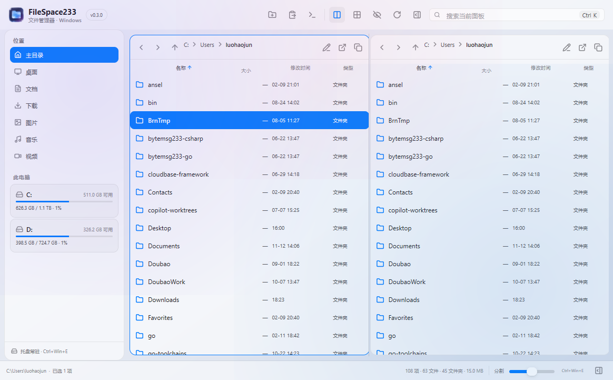
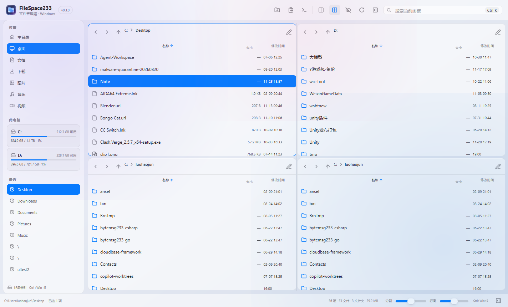
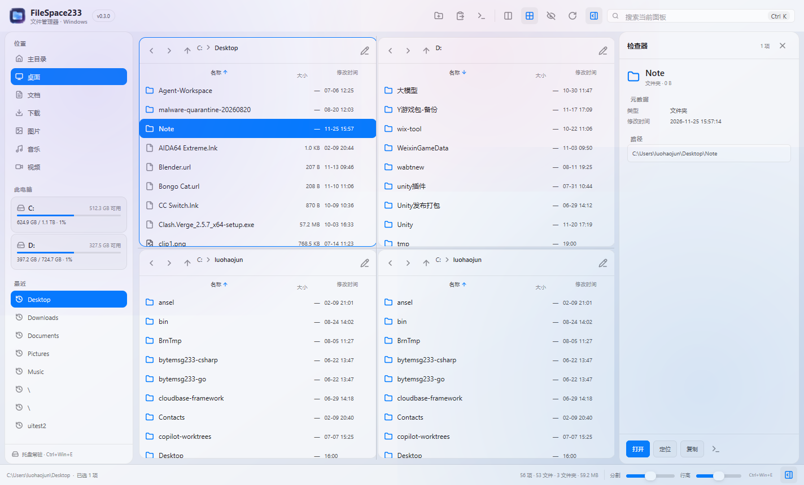
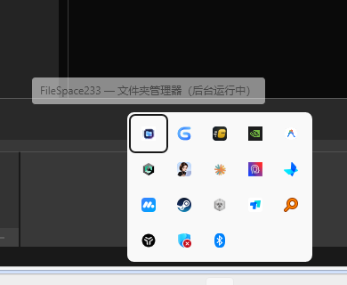

# FileSpace233

Windows 文件夹管理器：Go 1.27 + [MyGo](https://github.com/egoist/mygo) 原生 GPU UI + [Lobe MyGo](https://github.com/lobehub/lobe-mygo) 主题组件，纯 Go、`CGO_ENABLED=0`、无 WebView。

界面是 Apple 浅色 Liquid Glass：基础窗口跟随壁纸色渐变，顶栏、侧栏、文件面板、检查器和状态栏都使用 `glass.Glass` 的真实磨砂玻璃；应用图标、托盘图标和 MSI 图标同一套深蓝玻璃 squircle。



## 功能

- **Q-Dir 多面板**：默认左右 2 面板，可一键切 2×2 四宫格；每个面板独立目录、历史、排序、搜索和隐藏文件开关，活动面板蓝色边框。
- **文件操作**：内部剪贴板 + 系统文件剪贴板，复制 / 剪切 / 粘贴、回收站删除、重命名、新建文件夹 / 文本 / 创建副本，跨面板复制移动，拖放与外部导入，后台批量执行并显示进度。
- **批量重命名**：模板 `{name}` / `{full}` / `{ext}` / `{n}` / `{nn}` / `{date}`，自动保留扩展名，实时预览，大小写去重，目标冲突校验。
- **同步选择**：当前面板与下一个面板按名称同步选择，支持两边都有 / 仅本侧 / 仅其他侧 / 大小不同。
- **预览与哈希**：Inspector 内置图片预览和文本预览；MD5 / SHA-1 / SHA-256 / SHA-512 哈希计算。
- **路径与终端**：路径输入框直接跳转，最近位置，复制路径，在资源管理器打开；优先在 Windows Terminal 打开当前目录。
- **性能**：目录缓存、原地排序、同目录多面板共享一次读取、F5 共享刷新，刷新后保留选择。
- **全局呼出**：`Ctrl + Win + E` 唤起并聚焦窗口；热键被其他程序占用时自动走低级键盘钩子兜底。
- **磁盘容量**：侧边栏盘符显示已用 / 总量、百分比和容量进度条（75% 黄、90% 红）。
- **分栏拖拽**：底部 slider 和面板分隔条都能调整左右比例；四宫格下还可用中间横向分隔条调整上下比例。
- **后台常驻**：关闭主窗口只隐藏，托盘图标始终可见；托盘右键菜单提供“打开”和“退出”；重复启动会聚焦已有窗口。





## 安装

只发布 **Windows x86-64 MSI**：

```powershell
msiexec /i FileSpace233-0.3.0-x64.msi
```

安装到 `%LOCALAPPDATA%\Programs\FileSpace233`，无需管理员权限；创建开始菜单和桌面快捷方式，卸载保留用户数据。

## 开发

```powershell
$env:CGO_ENABLED = "0"
go run .

# 验收（Windows/amd64 本机）
powershell -ExecutionPolicy Bypass -File .\scripts\verify.ps1

# 只打 MSI
powershell -ExecutionPolicy Bypass -File .\scripts\build-msi.ps1

# 从 resources/icon-src.png 重生成 icon.png / tray.png / app.ico
powershell -ExecutionPolicy Bypass -File .\scripts\make-icons.ps1
```

产物：

- `dist/windows-amd64/FileSpace233.exe`
- `dist/FileSpace233-<version>-x64.msi`
- `dist/SHA256SUMS.txt`

## 结构

```
app.go              多面板状态、导航、热键、托盘、持久化
view.go             MyGo 原生 UI（Split、List、Inspector、玻璃面板）
theme.go            Apple Liquid Glass 主题、字体和色板
fileops.go          复制 / 移动 / 删除 / 新建 / 拖放 / 后台任务
rename.go           批量重命名
syncselect.go       同步选择
preview.go          Inspector 预览与哈希
internal/fsx/       目录读取、排序、磁盘容量、文件操作（无 UI 依赖）
resources/          icon.png / tray.png / app.ico / icon-src.png
build/wix/app.wxs   WiX 5 MSI 定义
scripts/            build-msi.ps1 / verify.ps1 / make-icons.ps1
```

工程约束与"每次处理后按爪"的验收规则见 [AGENTS.md](AGENTS.md)。

旧 WinUI 3 实现保存在分支 `archive/winui-0.1`。

MIT License.
